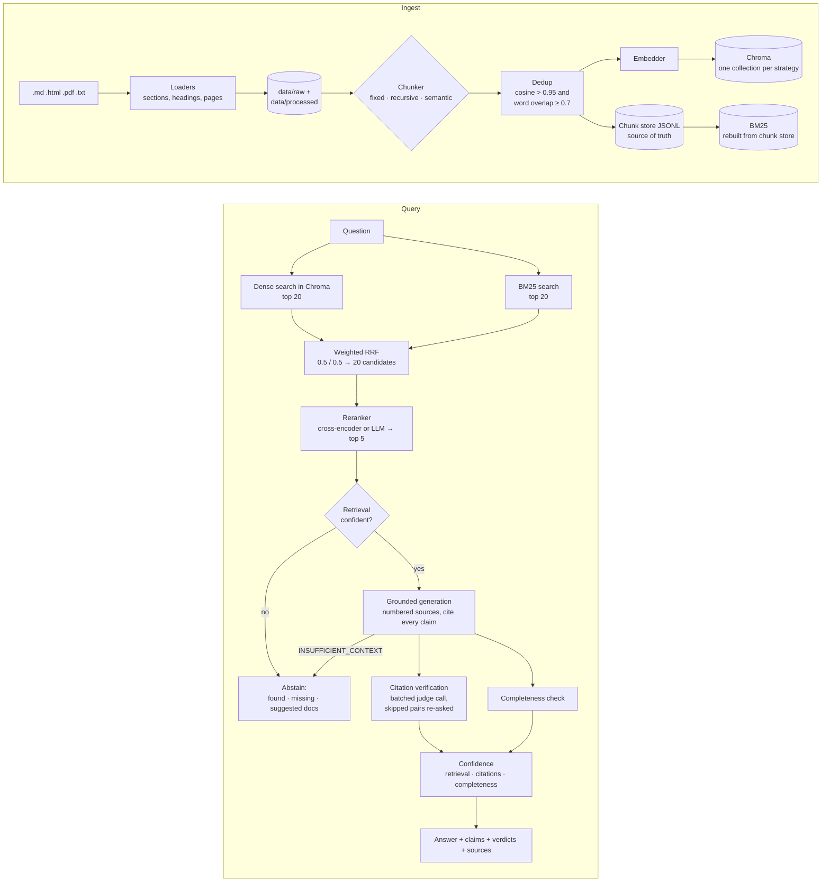

# docrag: question answering over technical docs, with citations that are checked

A RAG system over 103 real documentation files: FastAPI, Pydantic, HTTPX, Starlette and the
OAuth RFCs. It combines dense and keyword search, reranks the results, and answers with `[n]`
citations. A second model then checks every citation against the text it points to. When the
docs don't cover a question, it says so instead of guessing.

**Results on a 69-question eval suite**, which includes multi-hop, ambiguous and unanswerable
questions:

| Run | Correct | Faithful | Citation accuracy | Recall@5 | Unanswerable declined | Wrongly declined |
|---|---:|---:|---:|---:|---:|---:|
| GPT-4o (judge: GPT-4o) | **96%** | **98%** | **97%** | 95% | **8/8** | 2% |
| Fully local: qwen3 4B on an 8 GB Jetson (judge: the same 4B model) | **96%** | 88%¹ | 93% | 91% | **8/8** | 2% |

¹ A 4B judge grading its own output is noisy. For example, it scored short answers that were
correct, with verified citations, as 0% faithful. Treat this as a lower bound. Details are in
[the local eval report](reports/local_answer_eval.md).

The fully local setup runs with no API calls at all. It uses an Ollama server for the LLM and
embeddings, and a cross-encoder reranker on the laptop's CPU. It matches GPT-4o on correctness,
and it declines the same unanswerable questions.

---

## What it does

- **Three chunking strategies, switchable per request.** *Fixed* uses 512-token windows.
  *Recursive* splits within each section, so a chunk keeps its heading. *Semantic* breaks
  where the embedding similarity between sentences drops. Each strategy has its own index, so
  they can be compared on the same eval without re-ingesting.
- **Hybrid retrieval.** Dense search (cosine similarity) and BM25 are merged with weighted
  Reciprocal Rank Fusion. The BM25 tokenizer keeps identifiers like `response_model` and
  `HTTPException` whole, and also splits them into their parts.
- **Reranking.** The top 20 fused candidates go to a cross-encoder (or an LLM judge) and the
  best 5 are kept. Every chunk keeps its rank and score from each stage, so you can see why it
  was chosen.
- **Grounded answers with citation verification.** The answer is split into claims. A judge
  model marks each claim–source pair as `supported`, `partial` or `unsupported`, with a
  reason.
- **A confidence breakdown, not one number.** It reports retrieval relevance, the share of
  claims backed by a verified citation, and whether every part of the question was answered.
- **"I don't know" as a feature.** It abstains when retrieval is weak, or when the model
  reports that the context is insufficient. In that case it returns what it *did* find, what
  is missing, and which documents might help.
- **Near-duplicate removal.** A chunk is skipped as a duplicate only if its cosine similarity
  to an existing chunk is above 0.95 *and* the two share most of their words. Without the
  second check, distinct sections that share boilerplate were being dropped.
- **An eval suite and reports.** Each case has verbatim evidence quotes, so retrieval recall is
  measured exactly for every chunking strategy. LLM judges score correctness, faithfulness and
  citations. A sweep across strategy, retrieval mode, reranker, fusion weights and embedder
  writes Markdown reports.
- **Swappable providers.** The LLM can be OpenAI or Ollama. Embeddings can come from OpenAI,
  sentence-transformers running locally, or Ollama. Each embedder has its own index and its own
  confidence calibration.
- **Serving.** A FastAPI service, a Streamlit dashboard and a `docker compose` stack.

## Architecture



The chunk store is the single source of truth. Chroma vectors and the BM25 index are both built
from it, and `Indexer.check_sync` / `repair` detect and fix any drift between them. Re-ingesting
a document replaces its chunks in both indexes.

## Results

All numbers come from [`eval/golden.jsonl`](eval/golden.jsonl): 48 lookup, 8 multi-hop,
8 unanswerable and 5 ambiguous questions over the corpus. Each case lists verbatim quotes that
must appear in the retrieved chunks, so recall means the evidence itself was retrieved. A
retrieved chunk that is merely on the same topic doesn't count.

### Chunking strategy comparison

Answer quality with GPT-4o and the LLM reranker
([full report](reports/baseline_strategies_k10.md)). This run used the earlier retrieval
settings; see the lessons below.

| Strategy | Mode | Correct | Faithful | Citation acc | Recall@5 | MRR |
|---|---|---:|---:|---:|---:|---:|
| fixed (512 tokens) | hybrid | 93% | 98% | 96% | 89% | 76% |
| fixed | dense | 92% | 96% | 94% | 83% | 70% |
| **recursive (per section)** | **hybrid** | **96%** | 98% | **97%** | 95% | **87%** |
| recursive | dense | 95% | 99% | 97% | 98% | 88% |
| semantic | hybrid | 95% | 99% | 95% | 91% | 73% |
| semantic | dense | 92% | 100% | 93% | 88% | 72% |

Retrieval only, at the current settings: OpenAI embeddings, hybrid 0.5/0.5, cross-encoder
([sweep](reports/retrieval_sweep.md)).

| Strategy | Recall@5 | MRR | Evidence in the 20-candidate pool |
|---|---:|---:|---:|
| fixed | 82% | 69% | 96% |
| **recursive** | **91%** | **83%** | **98%** |
| semantic | 88% | 75% | 98% |

**Recursive chunking wins on this corpus.** Technical docs are already organised into small,
titled sections. Keeping a chunk inside one section, with its heading attached, beats both
fixed windows, which split code from the sentence that explains it, and semantic breakpoints,
which ignore the author's structure. Semantic chunking is a close second on recall, but it
ranks evidence lower (MRR 75% vs 83%).

### Hybrid vs dense-only

Hybrid search pays off most **when there is no reranker**, and on chunkings that don't follow
the document's structure:

| Embedder · strategy (no reranker) | Dense-only recall@5 | Hybrid recall@5 | Questions gained / lost |
|---|---:|---:|---:|
| bge-base · fixed | 72% | **88%** | +12 / −2 |
| bge-base · semantic | 77% | **85%** | +8 / −3 |
| OpenAI · fixed | 80% | **84%** | +5 / −3 |
| OpenAI · recursive | 86% | **88%** | +1 / −0 |

The questions hybrid search rescues name exact things: `deprecated=True`,
`response_model_exclude_unset`, `validation_alias` vs `serialization_alias`, "RFC 9700",
"HS256". BM25 matches the literal token. A dense embedding blurs it into "something about
FastAPI parameters".

**With a strong reranker, most of the gap closes.** For recursive chunks with the
cross-encoder, dense-only and hybrid both reach 91% recall@5 with OpenAI embeddings. The
dense candidate pool already contains the evidence 98% of the time, and the reranker brings it
to the top. Hybrid search's lasting contribution is getting keyword-only evidence *into the
pool*. For fixed chunks, pool recall rises from 90% to 96%. It still decides multi-hop
questions that mix identifiers from two documents. M07 asks for RFC 9700's PKCE requirement
plus RFC 6749's code lifetime. With the default local setup, dense search never retrieves the
RFC 9700 passage. BM25 ranks it 6th, fusion brings it into the pool at #15, and the
cross-encoder moves it to #1. Hybrid retrieves all of the evidence; dense-only gets half.

### Embedders

Retrieval-only comparison, recursive chunks, hybrid search, cross-encoder
([report](reports/embedder_comparison.md)):

| Embedder | Where it runs | Recall@5 | MRR |
|---|---|---:|---:|
| OpenAI `text-embedding-3-small` | API | 91% | 83% |
| `BAAI/bge-base-en-v1.5` | this laptop (sentence-transformers) | 91% | 83% |
| `nomic-embed-text` | Ollama on the Jetson | 91% | 83% |

**All three tie after reranking**, so the default local setup costs nothing in recall. Their
cosine scales differ a lot, though. bge puts almost every chunk between 0.70 and 0.80. A
threshold tuned on OpenAI's scale would rate every bge result as highly relevant. So each
embedder gets its own calibration band, taken from the golden set and used to turn cosine
into a 0–1 relevance score.

## Lessons from building it

Every one of these surfaced in the eval or in a test, and each fix is in the history:

1. **Hybrid search was quietly losing to dense-only.** Each retriever fetched 10 results, but
   the reranker pool held 20. Evidence that dense search ranked 11th–20th never reached hybrid
   fusion, even though dense-only mode searched deeper. Now every retriever searches at least
   as deep as the pool.
2. **0.7/0.3 RRF weights turned hybrid into dense-only.** With the fused list cut to 20, a
   keyword-only hit could never outscore the 20th dense hit, so BM25 couldn't add anything.
   Equal weights gave the best pool recall in the sweep.
3. **Cosine similarity alone is a bad duplicate test.** At > 0.95, bge flagged distinct
   sections that share boilerplate as duplicates (Starlette's `BackgroundTasks`, RFC 6749
   §4.4.3). Requiring word overlap ≥ 0.7 as well removed the false positives.
4. **Ollama's OpenAI-compatible endpoint silently truncates prompts.** The server's default
   context of 2,048 tokens drops the *start* of the prompt, which here is the system
   instructions and the first sources. The client now uses Ollama's native API with an
   explicit `num_ctx`, and raises an error if a prompt fills the whole context window.
5. **Small judges skip work.** The 4B verifier often returned verdicts for only some of the
   claim–source pairs it was given, and skipped pairs counted as failures. Asking again for
   only the skipped pairs raised citation accuracy from 88% to 93%. No pair is left without a
   verdict.
6. **Confidence needs an evidence floor.** An answer with one made-up claim out of two still
   scored 0.80 ("high"), because retrieval and completeness were perfect. Now "high" requires
   at least 75% of claims to be backed by a verified citation.
7. **Concurrency bugs only show up under load.** Chroma's embedded client deadlocked with 8
   eval threads, and parallel cross-encoder loads crashed torch. On the 8 GB Jetson, two
   in-flight 8k-token requests ran the model out of memory. The fixes: one lock around Chroma,
   a lock around model loading, and at most one Ollama chat call at a time.

## Quickstart

Requires Python 3.11+ and [uv](https://docs.astral.sh/uv/).

```bash
uv sync
cp .env.example .env    # then add OPENAI_API_KEY, or uncomment the Ollama block
uv run python scripts/fetch_corpus.py   # ~2.5 MB of docs into ./corpus
uv run python scripts/seed.py           # build the indexes for all three strategies
uv run docrag ask "How do I add custom headers to an HTTPException in FastAPI?"
```

`docrag retrieve "<query>" --all` prints every candidate's dense, BM25, fused and rerank scores.

### API and dashboard

```bash
uv run uvicorn docrag.api.main:app            # http://localhost:8000/docs
uv run streamlit run dashboard/app.py         # http://localhost:8501
```

| Endpoint | Purpose |
|---|---|
| `POST /v1/ask` | Answer with verified citations and a confidence breakdown. `debug: true` adds all 20 candidates with their per-stage ranks. |
| `POST /v1/verify` | Check the citations in *any* answer text against the sources retrieved for the question. |
| `POST /v1/retrieve` | Retrieval only, with every stage's scores. Cheap enough for side-by-side mode comparisons. |
| `GET /v1/documents` · `GET`/`DELETE /v1/documents/{id}` | List, inspect or remove indexed documents. |
| `POST /v1/ingest` | Upload a `.md`, `.html`, `.pdf` or `.txt` file and index it with any subset of strategies. |
| `GET /healthz` | Models in use, chunk counts, and whether the indexes are in sync. |

```bash
curl -s localhost:8000/v1/ask -H 'content-type: application/json' \
  -d '{"question": "What is the default timeout in HTTPX?", "strategy": "recursive", "mode": "hybrid"}'
```

If `DOCRAG_API_KEY` is set, ingest and delete require an `X-API-Key` header.

### Docker

```bash
docker compose up --build    # API on :8000, dashboard on :8501
```

`chroma` runs the vector store server. `seed` fetches the corpus if needed and builds the
indexes; when chunk stores already exist in `./data`, it only syncs their vectors into Chroma,
which takes seconds with the embedding cache. Then `api` (CPU-only torch, with the
cross-encoder included in the image) and `dashboard` start. Models are configured in `.env`
exactly as for a local run, so an Ollama server elsewhere on the network works from inside
the containers.

### Running fully locally

```bash
# .env
DOCRAG_LLM_PROVIDER=ollama
DOCRAG_OLLAMA_BASE_URL=http://<ollama-host>:11434
DOCRAG_GENERATION_MODEL=qwen3:4b-instruct-2507-q4_K_M
DOCRAG_JUDGE_MODEL=qwen3:4b-instruct-2507-q4_K_M
DOCRAG_EVAL_JUDGE_MODEL=qwen3:4b-instruct-2507-q4_K_M
DOCRAG_EMBEDDING_PROVIDER=ollama          # nomic-embed-text
DOCRAG_RERANKER=cross_encoder
```

```bash
uv run python scripts/seed.py             # builds data/index/ollama-nomic-embed-text/
```

On an 8 GB Jetson a typical answer takes about 21 s, including citation verification. Every
setting in [`config.py`](src/docrag/config.py) can be overridden with a `DOCRAG_` variable.

## Evaluation

```bash
# answer quality for one configuration
uv run python scripts/run_eval.py --strategies recursive --modes hybrid --rerankers cross_encoder

# retrieval-only sweep: no LLM calls, finishes in minutes
uv run python scripts/run_eval.py --retrieval-only --strategies fixed,recursive,semantic \
  --modes hybrid,dense --rerankers none,cross_encoder --dense-weights 0.7,0.5,0.3
```

Each run writes `reports/eval_<timestamp>.md` (and `.json`). A report contains:
- a table per configuration
- results by question type
- a hybrid-vs-dense diff listing the cases where retrieval changed
- the distribution of retrieval scores, used to calibrate the abstain threshold
- every case that wasn't fully correct

All LLM responses and embeddings are cached on disk, so a re-run only pays for prompts that
changed. The full GPT-4o comparison of six configurations cost $3.79.

```bash
uv run pytest    # 84 offline tests: fake LLM, hash embedder, temporary Chroma
```

## Project layout

```
src/docrag/
  ingest/       loaders (md, html, pdf, txt) and the raw/processed document store
  chunking/     fixed, recursive, semantic
  index/        embedders + cache, Chroma, BM25, chunk store, dedup, indexer
  retrieval/    dense, sparse, weighted RRF, rerankers, pipeline
  generation/   prompt, citation parsing and verification, confidence, abstain
  eval/         golden set, metrics and judges, runner, report comparisons
  api/          FastAPI app
dashboard/      Streamlit app (HTTP client of the API)
scripts/        fetch_corpus, seed, run_eval
eval/           golden.jsonl
reports/        committed eval reports
docker/         Dockerfiles; docker-compose.yml at the root
docs/demo.md    demo walkthrough script
```

## Limitations

- **The golden set is small.** It has 69 cases, written by the author from the corpus. One
  case is worth about 1.5 percentage points, so differences of a point or two between
  configurations are noise.
- **The LLM judges score the LLM.** The GPT-4o run uses a different model as judge
  (`gpt-4o-mini` verifies, `gpt-4o` grades). The local run grades itself with the same 4B
  model.
- **Retrieval confidence alone catches under half of the unanswerable questions** (3 of 8 in
  the local run). Questions close to the corpus's domain still retrieve plausible-looking
  chunks. The model's own "insufficient context" marker catches the rest. Both checks are
  needed.
- **Each document is indexed on its own.** Multi-hop questions depend on retrieving both
  halves in one top-5. Multi-hop recall (69–88%) is the weakest category.

The corpus is fetched from its upstream projects under their own licenses (MIT, BSD-3, and
the IETF Trust's terms for the RFCs) and is not redistributed in this repository.
